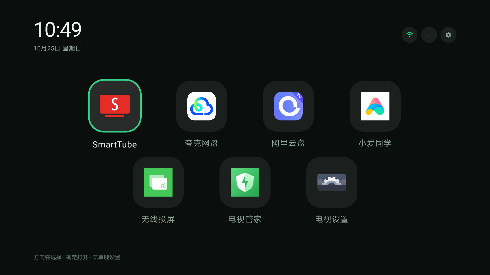
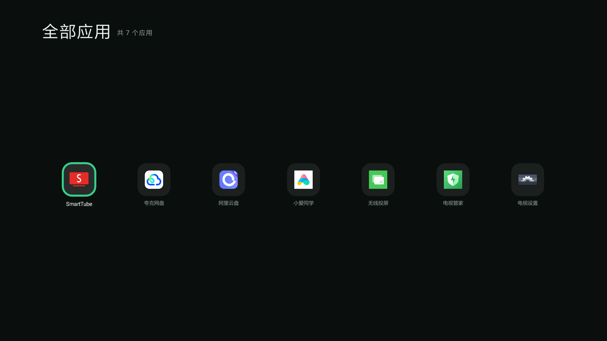
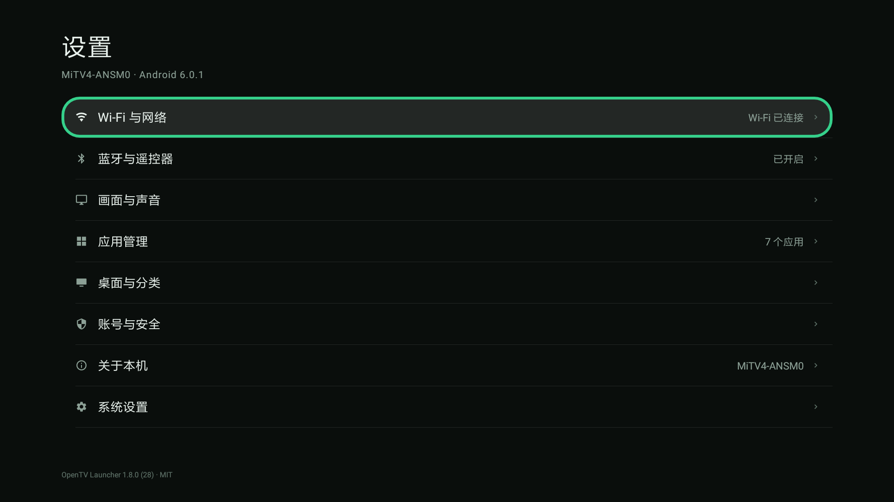

# OpenTV Launcher

面向 Android TV 的**极简启动器**，为小米电视 4A（Android 6.0.1 / 1080p）自用而写：
一屏只有时间、应用和三个入口，没有壁纸、没有动画、没有后台常驻服务。

---

## 界面

实机截图：







## 特性

**首页**

- 左上细体大时钟 + 日期，右上三个圆钮：网络、全部应用、设置
- 应用宫格：第三方应用优先，最多 12 个；**列数与图标尺寸按应用数量自适应**，
  7 个应用排成 4 + 3 的正三角，12 个回到 6 × 2
- 焦点环是绿色描边，聚焦图标轻微放大；第一行按 ↑ 到顶栏、最后一行按 ↓ 不出屏
- 长按磁贴：移动到其他分类 / 在桌面隐藏
- 安装、卸载、升级后自动刷新，隐藏与分类设置不会被覆盖

**全部应用**

- 系统自带应用都在这里，列数同样按数量自适应，内容垂直居中

**设置**

- 列表形式，每行直达系统对应页面：Wi-Fi、蓝牙、画面与声音、应用管理、
  桌面与分类、账号与安全、关于本机、系统设置
- 右侧实时显示 Wi-Fi 连接状态、蓝牙开关、已装应用数
- 系统页 1.2 秒没响应会给提示，不再让人对着黑屏干等

**其它**

- 纯离线除对时外不发请求；无壁纸下载、无进程监控、无桌面宠物
- 时钟走网络校时（这台电视的系统时钟会慢，NTP 常年不同步）

## 构建与安装

### 方式一：GitHub Actions（不需要本地 Android SDK）

推送代码后，Actions 里的 `Build OpenTV Launcher APK` 会自动编译，
在 Run 详情底部下载 `OpenTVLauncher-Release-APK`。

### 方式二：本地构建

需要 JDK 17 + Android SDK（platform 34、build-tools 34）。

```bash
./gradlew :app:assembleRelease
```

产物在 `app/build/outputs/apk/release/app-release.apk`，用仓库内的固定签名
（`keystore/opentv.p12`），可直接覆盖安装。

### 装到电视（不依赖 adb 二进制）

```bash
pip install -r deploy/requirements.txt
python deploy/deploy.py --host 192.168.1.50 --probe
python deploy/deploy.py --host 192.168.1.50 --install app-release.apk --set-home
python deploy/deploy.py --host 192.168.1.50 --list-stock
python deploy/deploy.py --host 192.168.1.50 --disable-stock com.mitv.tvhome
```

恢复原桌面：

```bash
python deploy/deploy.py --host 192.168.1.50 --restore-stock com.mitv.tvhome
```

> 电视需开启「开发者选项 → USB 调试」，并与电脑处于同一 Wi-Fi。首次连接时电视上会弹「允许 USB 调试」，记得允许。

### 兼容性

- 支持 **Android 6.0（API 23）及以上**
- 尺寸按屏幕密度换算：1080p / density 320 的机器上，磁贴 81dp、页面留白 66dp

### 小米电视 4A 特别注意

- 原桌面包名通常是 `com.mitv.tvhome`（PatchWall）或 `com.mitv.tvhome.atv`，先用 `--list-stock` 确认
- **先装新桌面再停用原桌面**，否则按 Home 可能落到工厂测试应用
- 系统设置主页（`com.xiaomi.mitv.settings/.entry.MainActivity`）会自己阻塞主线程十几秒，
  所以「设置」进的是本应用的精简设置页，每一行再直达系统细分页
- 部分固件的默认输入法指向未安装的百度输入法，软键盘弹不出来，因此分类管理不依赖 IME

---

## 工程结构

```
app/src/main/
├── AndroidManifest.xml                  # 权限：INTERNET（仅对时）/ QUERY_ALL_PACKAGES 等
├── java/com/openlauncher/tv/
│   ├── app/                             # Application（数据库 / 仓库单例）
│   ├── data/local/                      # Room：分类、应用项、DAO、迁移
│   ├── data/repository/                 # 应用扫描与同步
│   ├── receiver/                        # 安装/卸载/开机广播
│   ├── ui/home/
│   │   ├── MainActivity.kt              # 首页：时钟 + 宫格 + 三个入口
│   │   ├── AppGridLayout.kt             # 自绘网格，每行居中
│   │   ├── AppTileView.kt               # 极简磁贴（淡底 + 绿色焦点环）
│   │   ├── TileAdapter.kt               # 「全部应用」用的网格适配器
│   │   ├── AppIconCache.kt              # 图标加载缓存
│   │   └── TimeSync.kt                  # 网络校时
│   ├── ui/allapps/                      # 全部应用页
│   └── ui/settings/                     # 精简设置 + 系统页直达
└── res/
deploy/deploy.py                         # 纯 Python ADB 部署脚本
tools/verify_static.py                   # 无 SDK 环境下的静态自检
tools/push_via_api.py                    # 走 GitHub REST API 推送（本机 git push 不通）
docs/                                    # 需求 / 审查 / 对比等设计文档
design/                                  # 早期设计稿与实机截图
```

## 自检

没有本地 Android SDK 时，可以先跑静态检查（资源引用、ViewBinding id、括号平衡、import 是否存在）：

```bash
python tools/verify_static.py
```

## 协议

MIT。使用到的 AndroidX 组件遵循 Apache-2.0。
本项目仅供自用与学习，请自行承担改动系统桌面的风险。
